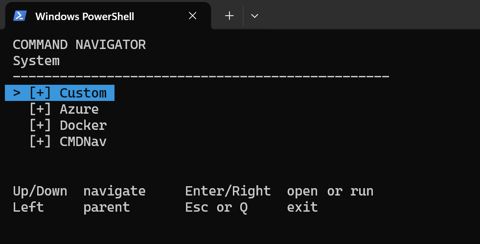

# CommandNavigator

A keyboard-first command menu for **PowerShell 7+**. Browse command folders in your terminal, optionally edit a command, and press **Enter** to run it.



## Install

```powershell
Install-PSResource CommandNavigator -Scope CurrentUser
cmdnav
```

For local development:

```powershell
Import-Module .\CommandNavigator.psd1 -Force
cmdnav
```

Requires a terminal supporting ANSI escape sequences. Commands using external programs require those programs to be installed.

## Navigation

| Key | Action |
| --- | --- |
| `Up` / `Down` | Select item |
| `Enter` / `Right` | Open folder or select command |
| `Left` / `Backspace` | Return to parent folder |
| `Esc` / `Q` | Exit menu |

In the command editor, use arrow keys, **Home/End**, **Backspace/Delete**, and typing. Long commands wrap across terminal lines. **Enter** runs the command; **Esc** cancels. A command with `"Editable": false` runs without opening the editor.

## Configuration

The module bundles default `commands.json` and `settings.json`. On first run, CommandNavigator copies missing files to:

```text
%LOCALAPPDATA%\CommandNavigator\
├── commands.json
└── settings.json
```

**Edit the AppData copies**, not the installed module files. Updates preserve existing user configuration. Deleting a configuration file causes it to be recreated from the bundled default on the next launch.

### Shared commands

Shared commands are available in every directory. The bundled `commands.json` contains three folders:

- **Network:** IP configuration, network adapters, DNS cache.
- **System:** Computer information, running processes (first 10), Windows services (first 10).
- **Command Navigator:** Create or edit project commands, System commands, Settings, Open config dir, Reset configuration.

A folder has `Name` and `Children`; an executable item has `Name` and `Command`. Optionally set `Editable` to `true` or `false` to override the global editor setting for that command:

```json
[
  {
    "Name": "Git",
    "Children": [
      { "Name": "Status", "Command": "git status" },
      { "Name": "Current branch", "Command": "git branch --show-current", "Editable": false }
    ]
  }
]
```

### Project commands

Use **Command Navigator → Create or edit project commands** to create and open `nav_commands.json` in the **current directory**, if it doesn't already exist. The file is initialized from the bundled `projectCommands.json` template:

```json
[
  {
    "Name": "My Project",
    "Children": [
      { "Name": "List first 10 items", "Command": "Get-ChildItem | Select-Object -First 10" },
      { "Name": "Echo Hello World", "Command": "Write-Host 'Hello World'" }
    ]
  }
]
```

CommandNavigator reads project commands only from the **exact current working directory** (it does not search parent folders). When a project file exists, shared commands appear under an additional **System** folder.

### Settings

The default `settings.json` is:

```json
{
  "WriteHistory": false,
  "EditableCommands": true,
  "UseConsoleEditor": true
}
```

| Setting | Behavior |
| --- | --- |
| `WriteHistory` | Explicitly add executed commands to PSReadLine history when enabled |
| `EditableCommands` | Show the command editor by default; individual `Editable` values override it |
| `UseConsoleEditor` | Use the terminal `edit` command to open JSON files; when `false`, use the Windows default application |

`UseConsoleEditor: true` requires Microsoft Edit (`edit`) to be installed. The **Command Navigator** menu provides shortcuts to edit shared commands and settings, open the config folder, or reset configuration.

**Warning:** **Reset configuration** deletes the AppData configuration folder and your customizations. The bundled defaults are copied again on the next `cmdnav` run.

## Update

```powershell
Update-PSResource CommandNavigator
```

Restart PowerShell or reload the module to use the updated version. Your AppData files are preserved, so review new bundled defaults if a release changes the configuration format.

## Security

Commands in JSON files are executed as PowerShell code. Review files from other projects before running their commands, and avoid storing secrets in command strings or command history.
